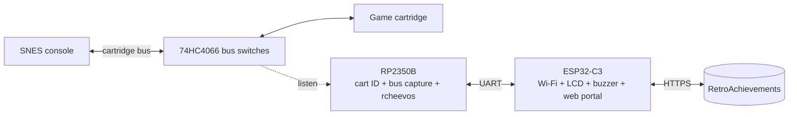

# SNES RA Adapter Project

Repository of the **SNES RetroAchievements Adapter**, a maker project that brings Internet connectivity and achievements to the original Super Nintendo, using a real console and a real cartridge, with no PC and no emulator. It is the big brother of the [NES RA Adapter](https://github.com/odelot/nes-ra-adapter), and it is powered by the amazing [RetroAchievements](https://retroachievements.org) community.

  

<!-- TODO: replace with the YouTube link when the video is out -->
**Video:** *coming soon*

---

## Table of Contents

- [Disclaimer](#disclaimer)
- [Introduction](#introduction)
- [Getting Started (How to Build)](#getting-started--how-to-build)
- [Architecture and Functionality](#architecture-and-functionality)
- [Compatibility](#compatibility)
- [Limitations](#limitations)
- [General Information](#general-information)
- [Version History](#version-history)
- [Roadmap](#roadmap)
- [Contributions](#contributions)
- [License](#license)
- [FAQ](#faq)
- [Acknowledgments](#acknowledgments)
- [Similar Projects](#similar-projects)

---

## Disclaimer

The project is not responsible for any use or damage it may cause. Build and use it at your own risk.

This is a **PROTOTYPE**. It works, but it still needs to evolve into a final version: revised hardware, a case, extensive testing and easy replication. v0.1 has no case, needs a small mod (2 cut traces and 2 wires), and was tested on an opened console. Only build it if you know what you're doing.

---

## Introduction

The **SNES RA Adapter** sits between the cartridge and the console, like a Game Genie. It turns your original Super Nintendo into an Internet-connected machine that unlocks RetroAchievements in real time:

- **Identifies the game** by reading the whole cartridge and computing the same MD5 hash RetroAchievements uses for ROM files. It knows exactly which game, and which version, is in the slot.
- **Monitors the console memory:** it listens to every write to the 128 KB of WRAM (DMA included) and to the cartridge save RAM, and runs rcheevos, the same code emulators use, 60 times per second.
- **Shows your progress:** on its own 1.3" screen, with a buzzer, and on a web page you can open on your phone (`http://snes-ra-adapter.local`). No app needed.

  
  

### Repository Organization

- **[hardware](hardware)**: KiCad project and Gerber files of prototype v0.1, the bill of materials, the required mod and the assembly guide.
- **[snes-pico-firmware](snes-pico-firmware)**: firmware for the WeAct Studio RP2350B Core Board. It handles cartridge identification, bus capture and rcheevos.
- **[snes-esp-firmware](snes-esp-firmware)**: firmware for the ESP32-C3 Super Mini. It handles Wi-Fi, the RetroAchievements API, the LCD, the buzzer and the web portal.
- **[misc](misc)**: auxiliary files: the `TFT_eSPI` configuration for the LCD.

---

## Getting Started / How to Build

### 1. Acquire the parts

All parts are through-hole: a 74HC4066 bus switch bank, a WeAct RP2350B board, an ESP32-C3 Super Mini, a 1.3" ST7789 LCD, a SNES 62-pin cartridge slot and a few passives. The full list is in the **[hardware bill of materials](hardware/README.md#bill-of-materials)**.

### 2. Order the PCB

Upload [`hardware/proto-v0.1/fab/snes-ra-proto-v0.1.zip`](hardware/proto-v0.1/fab/snes-ra-proto-v0.1.zip) to a pcb fab:

- 2 layers, **1.2 mm** thick (like an original cartridge).
- ENIG finish.
- Gold fingers with a 45° bevel.

### 3. Do the mod and assemble the board

Prototype v0.1 has A22 and /RD swapped on the Pico. **Every board needs 2 cut traces and 2 wires**, which are easier before the WeAct is soldered. The step by step, with pictures, and the assembly order are in the **[hardware README](hardware/README.md#required-mod-2-cuts--2-wires)**.

### 4. Flash the firmware

Flash both modules over USB **before** plugging the board into the console.

1. **Raspberry Pi Pico (WeAct RP2350B):**
   - Hold the **BOOT** button and connect the board over USB.
   - Copy `snes-pico-firmware.uf2` to the `RP2350` drive that shows up.
   - To build the `.uf2` yourself, see [snes-pico-firmware](snes-pico-firmware/README.md#building).
2. **ESP32-C3 Super Mini:**
   - Compile and upload with the Arduino IDE.
   - Then upload the `data` folder (web portal) to LittleFS.
   - Before compiling, copy [`misc/TFT_eSPI/User_Setup.h`](misc/TFT_eSPI/User_Setup.h) into your `TFT_eSPI` library folder.
   - The step by step is in [snes-esp-firmware](snes-esp-firmware/README.md).

### 5. First use

1. With the console **off**, plug the adapter into the cartridge slot and the game into the adapter.
2. Turn the console on. On the first boot, the screen asks you to configure the adapter:
   - With your phone, connect to the Wi-Fi network **`SNES_RA_ADAPTER`** (password `12345678`).
   - Open `http://192.168.1.1`.
   - Enter your Wi-Fi network and your RetroAchievements username and password.
3. The adapter connects, logs in, reads the cartridge and starts the game. Have fun!
4. To follow your progress on the phone, open `http://snes-ra-adapter.local` (the phone must be on the same Wi-Fi network).

To erase the configuration, hold the button (SW1) for 5 seconds while the adapter starts.

---

## Architecture and Functionality

### Raspberry Pi Pico (WeAct RP2350B, 48 GPIO)

- **Game identification:**
  - At power-on it holds the console in reset and isolates it from the cartridge with the bus switches.
  - It reads the whole ROM and computes its MD5. It also handles ROMs whose size is not a power of two, which show up mirrored on the bus.
  - Then it releases the console.
- **Memory monitoring (core 1):**
  - PIO state machines capture **one sample per write cycle** on the bus: WRAM writes, cartridge SRAM writes and the B-bus WRAM port ($2180–$2183), which games use to DMA data into WRAM.
  - The two PIOs of the RP2350B share an overlapping GPIO window, so no pin is duplicated.
  - Core 1 keeps a full copy of the 128 KB WRAM and of the cartridge SRAM.
- **Achievements (core 0):**
  - rcheevos runs on every **real vblank**, detected from the OAM DMA burst the game fires in the NMI handler, with a timer as fallback.
  - Each frame is evaluated on an atomic snapshot of the memory.
  - Pressing RESET on the console resets the rcheevos runtime state, just like an emulator.

More details in [snes-pico-firmware](snes-pico-firmware/README.md).

### ESP32

- **Connectivity and interface:** gives the SNES Internet access, talks to the RetroAchievements API, and shows the achievements on the LCD with sound effects on the buzzer.
- **Configuration:** Wi-Fi and RetroAchievements credentials are stored in EEPROM and set from a smartphone, through the ESP32 access point.
- **Web portal:** a dashboard on your local network (`http://snes-ra-adapter.local`). It shows:
  - the game, rich presence and progress;
  - the full achievement list with filters;
  - live unlock, challenge and progress notifications;
  - an LCD theme picker.

  The Pico is the single source of truth: the ESP32 only relays the data.

---

## Limitations

- **SA-1 games:** the SA-1 is a second processor inside the cartridge, about three times faster than the SNES CPU. It runs the game from its own memory, and most of that data never reaches the cartridge connector, so the adapter can't see it. This is a hardware limit.
- **Large cartridge save RAM:** only LoROM SRAM up to 32 KB and HiROM SRAM up to 8 KB are tracked. Achievements that read the save RAM of carts with more SRAM (Star Ocean, Tales of Phantasia, Dragon Quest VI) won't work yet. Achievements based on the console RAM are not affected.
- **Casual mode:** the prototype runs in casual mode.
- **Flash carts** (SD2SNES / FXPAK, EverDrive): not supported. The adapter needs to read the cartridge to identify the game, and with a flash cart it reads the flash cart's menu instead. To use RetroAchievements with an FXPAK, see [RA2Snes](#similar-projects).
- **Console shell:** v0.1 is a bare board, tested on an opened console. A case and a board that fits a SNES with its shell are on the [roadmap](#roadmap).
- **PAL consoles:** the firmware supports 50 Hz, but it has not been tested on a PAL console yet.

---

## General Information

- **Power:** the adapter is powered by the console's +5 V (cartridge connector). A Schottky diode keeps the USB of the modules from powering the console.
- **Logic level conversion (5 V vs 3.3 V):** there is no level shifter.
  - The RP2350 inputs are 5 V tolerant, so the Pico listens to the bus directly.
  - The Pico only drives the cartridge (at 3.3 V, which the ROMs read as HIGH) during identification, while the console is isolated by the bus switches and held in reset.

---

## Version History

- **Prototype v0.1 (2026-11):** first PCB. Everything is through-hole, with a 74HC4066 bus switch bank. Adds automatic cartridge identification (ROM MD5), cartridge SRAM capture, the B-bus WRAM port, vblank-paced frames, console reset detection and a web portal with LCD themes.

  

- **"Spaghetti edition" (2026-06):** WeAct RP2350B (48 GPIO) with almost 50 wires soldered straight to the console motherboard. It validated the whole bus capture by beating Star Fox, Mega Man X and EarthBound. The game was still picked from a list.
- **Proof of concept (2025-04):** reused the NES adapter with the original Pico. It could not see the whole memory range or identify games, but it caught memory writes and unlocked a few achievements.

---

## Roadmap

- **v0.1b:**
  - A22 and /RD fixed in copper (no mod).
  - ESP32-S3-Zero, for more RAM for large achievement sets.
  - A 3D-printed case in the style of the Super Game Boy, so it fits a SNES with its shell.
- **Slim version:** SN74CBT3245 bus switches, 4-layer board, about the size of a cartridge.
- **Firmware:** large SRAM carts (A17–A23 capture), ExHiROM, hardcore mode and leaderboards.

---

## Contributions

Everyone is welcome to contribute!

- Submit improvements and pull requests via GitHub.
- Join our Discord channel: [https://discord.com/invite/6eYGq7NNfF](https://discord.com/invite/6eYGq7NNfF)
- Support us on [Patreon](https://www.patreon.com/RetroAchievementsHardwareLab) or by [buying a coffee](https://buymeacoffee.com/nes.ra.adapter).

---

## License

- The source code is distributed under the **GPLv3** license.
- The PCB design files are distributed under the **CC-BY-4.0** license.

---

## FAQ

- **Q: Are you planning to sell the adapter?**
- **A:** No. This is a fully open-source, community-driven DIY project.
 

- **Q: So how can I get one?**
- **A:** It's a DIY project: you can build it yourself! Every part is through-hole, so it is a good soldering project. As with other open-source projects, the community may step in to build units for people who don't want to build their own.
 

- **Q: Do I need to modify my SNES?**
- **A:** No. The adapter plugs into the cartridge slot. The prototype v0.1 is a bare board, though, and was tested on an opened console. The next revision fits a SNES with its shell.
 

- **Q: Do I need to connect it to a computer?**
- **A:** No! It has built-in Wi-Fi and all achievement processing happens on the adapter. You configure it from your phone.
 

- **Q: Will it work with Super Famicom?**
- **A:** The cartridge connector is the same, but it has not been tested yet.
 

- **Q: Why doesn't Super Mario RPG work?**
- **A:** It uses the SA-1 chip, which keeps the game data inside the cartridge, where the adapter can't see it. See [Limitations](#limitations).
 

---

## Acknowledgments

- Thanks to **RetroAchievements** and its community for providing achievements for nearly all games, and for always supporting, testing and sharing.
- Thanks to the **Patreon supporters**, who covered part of the cost of these prototypes.

## Similar Projects

- **RA2Snes**: [https://github.com/Factor-64/RA2Snes](https://github.com/Factor-64/RA2Snes). A program built with Qt and C++ that bridges the QUsb2Snes web server and the rcheevos client, so you can unlock achievements on real Super Nintendo hardware through the SD2Snes USB port.
- **NES RA Adapter**: [https://github.com/odelot/nes-ra-adapter](https://github.com/odelot/nes-ra-adapter). The same idea for the NES and the Famicom.
