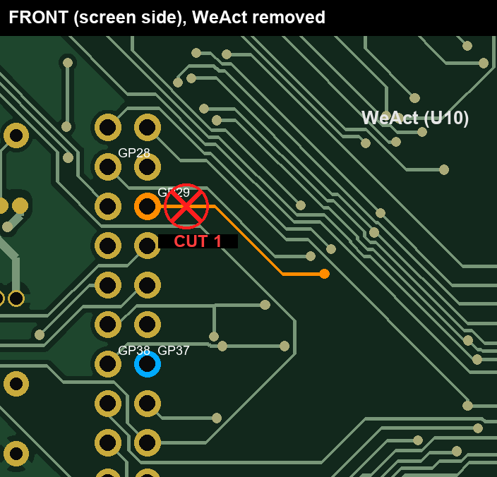
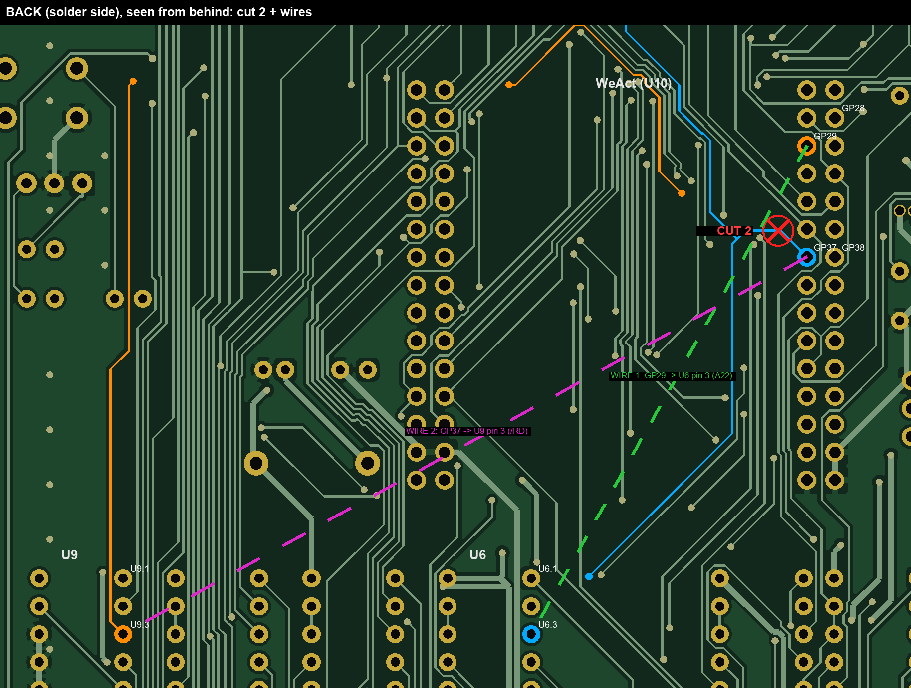

# SNES RA Adapter: hardware

The adapter is a single board that works like a Game Genie. Its bottom edge plugs into the console's cartridge slot, and the game cartridge plugs into a female slot on its top edge. The screen sits on the front.

```
hardware/
  proto-v0.1/        KiCad 9 project of prototype v0.1, exactly as fabricated and tested
    fab/             Gerber + drill zip, ready to upload to a pcb fab
  lib/               custom symbols and footprints used by the project (snes-ra-adapter)
  docs/
    netlist.md       full connection table (edge pin -> switch -> Pico GPIO, ESP32, power)
    v0.1-mod/        images of the 2 cuts + 2 wires every v0.1 board needs
```

<p align="center">
  
  
</p>

---

## Prototype v0.1

- **Board:** 120 × 110 mm, 2 layers, 1.2 mm thick (the same as an original cartridge). Every part is through-hole, so it is beginner-friendly to solder.
- **Bus isolation:** 9× 74HC4066 (DIP-14) on 35 lines: A0–A23, D0–D7, /RD, /WR and /CART. While the adapter reads the cartridge, the switches open and the console is held in reset. During gameplay they stay closed and the Pico only listens.
- **Microcontrollers:** WeAct Studio RP2350B Core Board (48 GPIO) and ESP32-C3 Super Mini, both soldered as modules.
- **Screen:** 1.3" 240×240 ST7789 LCD (7-pin) in a 1x7 female header.
- **Bottom strip (30 mm):** this is the part that goes into the console. It is 89 mm wide and has no components.
- **Pico USB-C:** points down, through a corridor with no components, so the cable still fits with the board in the console.
- **Back face:**
  - The ESP32-C3 sits behind the LCD, with its USB on the left edge. There is no copper plane under its antenna.
  - The buzzer (BZ1), its driver transistor (Q2) and R4 are next to it.
- **Tested on an opened console.** v0.1 has no case and was not designed around the SNES shell or the power-switch lock. The case and the shell fit come in the next revision (v0.1b).

The complete connection table is in [docs/netlist.md](docs/netlist.md).

### Bill of materials

| Qty | Part | Refs |
|---:|---|---|
| 1 | PCB (see [Ordering the PCB](#ordering-the-pcb)) | |
| 1 | SNES 62-pin cartridge slot, 2.5 mm pitch | J2 |
| 9 | 74HC4066 DIP-14 (sockets optional) | U1–U9 |
| 1 | WeAct Studio RP2350B Core Board + 2× female headers | U10 |
| 1 | ESP32-C3 Super Mini (the PLUS version with an external antenna works better) + female headers | U11 |
| 1 | LCD 1.3" 240×240 ST7789, 7 pins + 1x7 female header | J3 |
| 9 | 100 nF ceramic capacitor (5 mm pitch) | C1–C9 |
| 1 | 47 µF 16 V electrolytic capacitor | C10 |
| 1 | 10 µF 10 V (or higher) electrolytic capacitor | C11 |
| 1 | 1N5817 Schottky diode | D1 |
| 2 | BC548 NPN transistor | Q1, Q2 |
| 3 | 10 kΩ resistor | R1, R3, R5 |
| 2 | 1 kΩ resistor | R2, R4 |
| 1 | Passive buzzer, 12 mm | BZ1 |
| 1 | 6×6 mm tactile push button | SW1 |
| 1 | Bi-color LED 3 mm, green/red, common cathode (*optional*) | D2 |
| 2 | 100 Ω resistor (*optional*, only with D2) | R6, R7 |
| 1 | 1x3 pin header (*optional*, UART debug) | J4 |
| 2 | Short pieces of thin insulated wire (for the [mod](#required-mod-2-cuts--2-wires)) | |

Notes:

- **Resistors:** mounted standing up (2.54 mm pitch).
- **JP1:** a solder jumper that comes bridged 1-2 from the factory (pull-down, so the bus starts isolated at power-on). Leave it as is.
- **BZ1:** the footprint has 5.0 mm between the legs (TDK PS1240). The common 12 mm passive buzzers have 6.5 mm, so bend the legs inwards to fit.
- **C10 and C11:** the footprints are for Ø6.3 mm / 2.5 mm and Ø5 mm / 2.0 mm parts. Smaller capacitors (Ø4 mm, 1.5 mm pitch) also fit, just open the legs a little.
- **J4:** an optional UART debug header (1 GND, 2 Pico TX, 3 Pico RX).

### Ordering the PCB

Upload [`proto-v0.1/fab/snes-ra-proto-v0.1.zip`](proto-v0.1/fab/snes-ra-proto-v0.1.zip) to a pcb fab. These are the settings used for the tested boards:

- 2 layers, **1.2 mm** thick.
- ENIG surface finish.
- **Gold fingers: yes**, with a **45° bevel** on the edge connector.

### Required mod (2 cuts + 2 wires)

Prototype v0.1 has two Pico pins swapped. A22 goes to GP37 and /RD goes to GP29, but the firmware needs **A22 on GP29**. That is because GP29 is inside the PIO0 capture window, and A22 tells a WRAM mirror access from a direct $7E/$7F access. **Every v0.1 board needs this mod.** It is already fixed in copper in the next revision.

The marks below are on the WeAct (U10) footprint, on the PCB itself. The cuts are easiest **before** soldering the WeAct headers. Use a hobby knife, and scrape until the copper is gone.

1. **Cut 1 (front, screen side):** cut the trace that leaves the **GP29** pad, right next to the pad.

   

2. **Cut 2 (back, solder side):** cut the trace that leaves the **GP37** pad, right next to the pad.
3. **Wire 1:** solder a wire from **GP29** to **U6 pin 3** (A22).
4. **Wire 2:** solder a wire from **GP37** to **U9 pin 3** (/RD).

   

5. **Check with a multimeter:**
   - GP29 must have continuity with U6 pin 3, and **not** with U9 pin 3.
   - GP37 must have continuity with U9 pin 3, and **not** with U6 pin 3.

The Pico firmware expects the mod by default (`#define A22_ON_GP29` in `snes-pico-firmware/src/main.c`).

### Assembly order

1. **Mod:** make the [2 cuts](#required-mod-2-cuts--2-wires).
2. **Low parts first:** resistors, diode, ceramic capacitors and the 74HC4066 (or their sockets). Watch the orientation of U1–U9.
3. **Back parts:** ESP32-C3 headers, BZ1, Q2 and R4. Their pins come out on the front, under the LCD, so solder them **before** the LCD header.
4. **Front parts:** Q1, electrolytic capacitors, SW1, the optional D2 and the WeAct headers.
5. **LCD header and cartridge slot (J2).**
6. **Mod wires:** solder the 2 wires on the back.
7. **Before the first power-up:**
   - Check that there is no short between +5V and GND.
   - Flash both firmwares over USB, **with the board out of the console**.
   - Then plug the modules in.

### Status

- **v0.1:** fabricated (Oct 2026) and tested with the mod above.
- **Games beaten / tested:** Super Mario World, Super Metroid, Star Fox and Yoshi's Island (see the main [README](../README.md)).
- **KiCad files:** ERC has 0 violations. DRC shows 0 violations, 0 unconnected items and 0 schematic parity issues. The files are the ones that went to fab, so they still have the swap the mod fixes.

---

## What's next

- **v0.1b:** v0.1 with A22 and /RD fixed in copper, ESP32-S3-Zero instead of the C3 (more RAM for large achievement sets) and parts placed for a 3D-printed case in the style of the Super Game Boy, so it fits a SNES with its shell.
- **Slim version:** SN74CBT3245 bus switches instead of the 4066s, 4 layers, about the size of a cartridge board.

These boards are still being validated and will be published once they are tested.

## License

The PCB design files are distributed under the **CC-BY-4.0** license.
